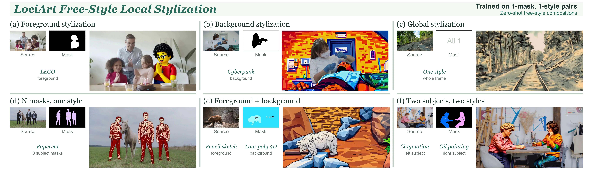
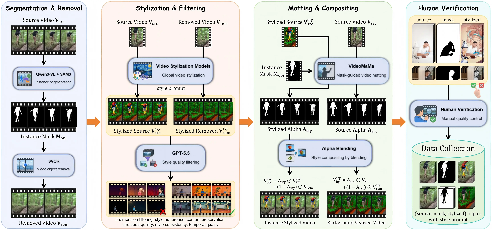
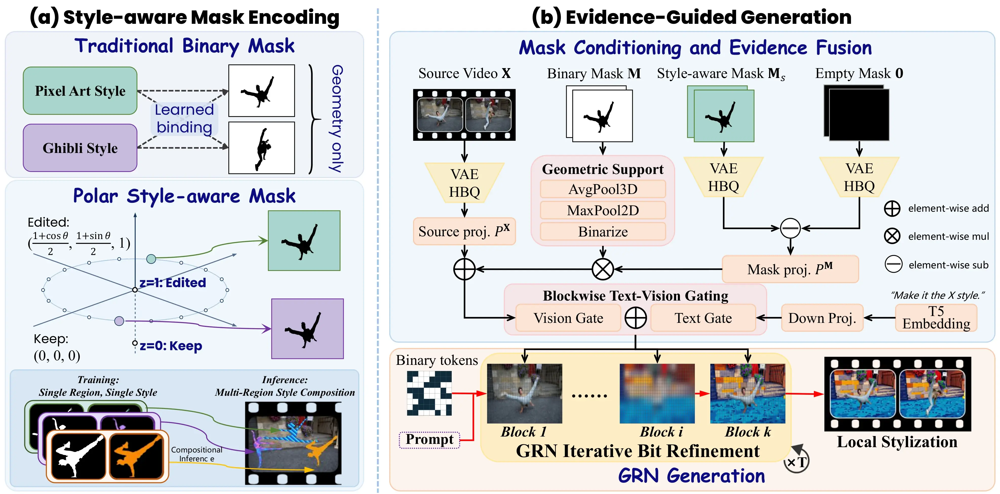
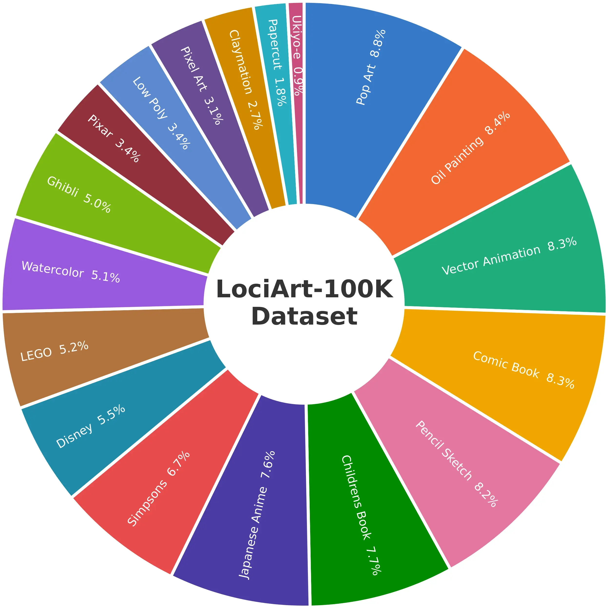
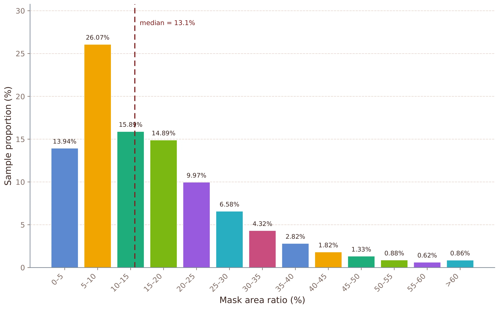

<div align="center">

<h1>LociArt</h1>

<p>
Official project page and method overview for <em>LociArt: A Unified Paradigm for Free-Style Local Video Stylization</em>
</p>

<a href="https://arxiv.org/abs/26xx.xxxxx"></a>
<a href="https://lociart-page.pages.dev/" target="_blank" rel="noopener noreferrer"></a>
<a href="https://huggingface.co/HigherHu/GRNStyle"></a>
<a href="https://huggingface.co/datasets/HigherHu/LociArt-100K"></a>
<a href="https://www.apache.org/licenses/LICENSE-2.0"></a>

<p>Yuxuan Chen<sup>1,&dagger;</sup>, Feng Xie<sup>2,&dagger;</sup>, Jiagao Hu<sup>1,*,&dagger;</sup>, Fuhao Li<sup>1</sup>, Zepeng Wang<sup>1</sup>, Fei Wang<sup>1</sup>, Daiguo Zhou<sup>1</sup></p>

<p><sup>1</sup> MiLM Plus, Xiaomi Inc. &nbsp;&nbsp; <sup>2</sup> Xi'an University of Electronic Science and Technology</p>

<p><sup>&dagger;</sup> Equal contribution. &nbsp;&nbsp; <sup>*</sup> Corresponding author.</p>

<p>⭐ If LociArt is helpful to your projects, please help star this repo. Thanks! 🤗</p>

</div>

## News

- **[October 2026]** The paper and project page are now available.

## Updates

- [ ] Release model weights.
- [ ] Release training and inference code.
- [ ] Release the LociArt-100K dataset.
- [x] Publish the paper and project page.

## Overview

**LociArt** is a unified paradigm for free-style local video stylization. It explicitly controls both **where to stylize** and **what style to apply**, while preserving non-target content and temporal consistency. Instead of applying one artistic style to an entire video, LociArt supports foreground editing, background editing, global stylization, multiple masks with one style, and multiple regions with distinct styles.

<p align="center">

</p>

The project consists of three closely connected components:

- **LociArt-100K Dataset:** 100K paired 720P videos for learning local stylization and non-target preservation.
- **GRNStyle:** a 2B video generation model that binds style identities to spatial regions and performs localized artistic editing.
- **LociArt Benchmark:** a region-aware benchmark containing 80 source videos, 84 target masks, and 168 foreground/background cases.

### Method

#### 1. LociArt Data Construction

Each sample contains a source video, editing mask, style instruction, and locally stylized target. The dataset is built in four stages:

1. **Object removal:** Track and remove salient objects to reconstruct clean background content.
2. **Global stylization:** Stylize and filter source and object-removed videos for visual and temporal quality.
3. **Matting and compositing:** Matte the original and stylized objects, then compose foreground- and background-stylized pairs.
4. **Human verification:** Keep samples with faithful preservation, clean boundaries, and stable motion. The final dataset contains 100K pairs across 18 styles.

<p align="center">

</p>

#### 2. GRNStyle

GRNStyle builds on GRN and GRNEdit and transforms only the selected regions.

- **Polar style-aware mask:** Encode each style as an equal-norm direction inside its target region, jointly specifying where and what to stylize.
- **Representation-geometry conditioning:** Combine encoded mask features with raw-mask spatial support for temporal context and precise localization.
- **Compositional inference:** Support multiple regions and styles in one refinement pass without multi-region training pairs.

Source evidence guides content preservation throughout refinement.

<p align="center">

</p>

#### 3. LociArt Benchmark

The benchmark contains 80 source videos and 84 masks, evaluated under foreground and background stylization for 168 cases.

- **Foreground:** Edit the masked object.
- **Background:** Edit the complement of the mask.

SPS measures regional style fidelity; complementary metrics cover CLIP alignment, preservation, temporal consistency, and VLM judgments.

## LociArt-100K Dataset

LociArt-100K is a large-scale paired dataset for free-style local video stylization. It contains **100K source–target video pairs at 720P**, each paired with an editing mask and style instruction. The data cover **18 artistic styles** and a wide range of target sizes, from small local objects to large background regions.

- **Paired supervision:** source video, editing mask, style instruction, and locally stylized target.
- **Diverse styles:** 18 categories, including Pop Art, Oil Painting, Pencil Sketch, Ghibli, Watercolor, LEGO, and more.
- **Broad mask coverage:** foreground mask ratios range from below 5% to over 60%, with a median of 13.1%.
- **Temporal alignment:** source, mask, and target videos maintain frame correspondence for consistent local editing.

<p align="center">
 &nbsp;&nbsp; 
</p>

<p align="center"><em>Style-category distribution and foreground mask-area distribution in LociArt-100K.</em></p>

## Results

Please visit the **[Results section on the project page](https://lociart-page.pages.dev/#results)** for quantitative comparisons, qualitative examples, user-study results, and replay-free style expansion.

## Acknowledgements

Our work benefit from the following open-source projects:

- [GRN](https://github.com/bytedance/GRN)
- [VACE](https://github.com/ali-vilab/VACE)
- [Ditto](https://github.com/EzioBy/Ditto)
- [SVOR](https://github.com/xiaomi-research/svor)
- [VideoMaMa](https://github.com/cvlab-kaist/VideoMaMa)


## Citation

If you find LociArt useful for your research, please consider citing our paper:

```bibtex
@article{chen2026lociart,
  title   = {LociArt: A Unified Paradigm for Free-Style Local Video Stylization},
  author  = {Chen, Yuxuan and Xie, Feng and Hu, Jiagao and Li, Fuhao and Wang, Zepeng and Wang, Fei and Zhou, Daiguo},
  year    = {2026},
  note    = {Preprint},
  url     = {https://higherhu.github.io/lociart}
}
```
